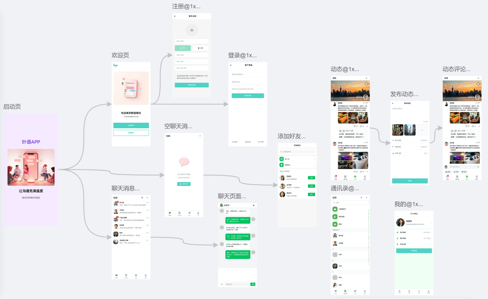
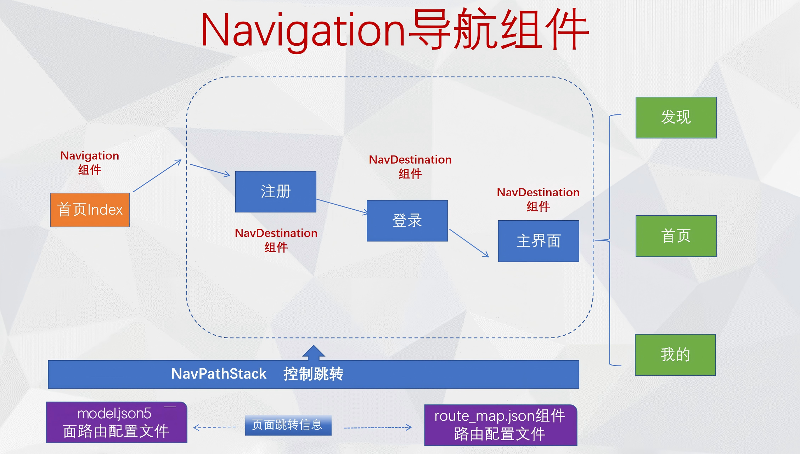
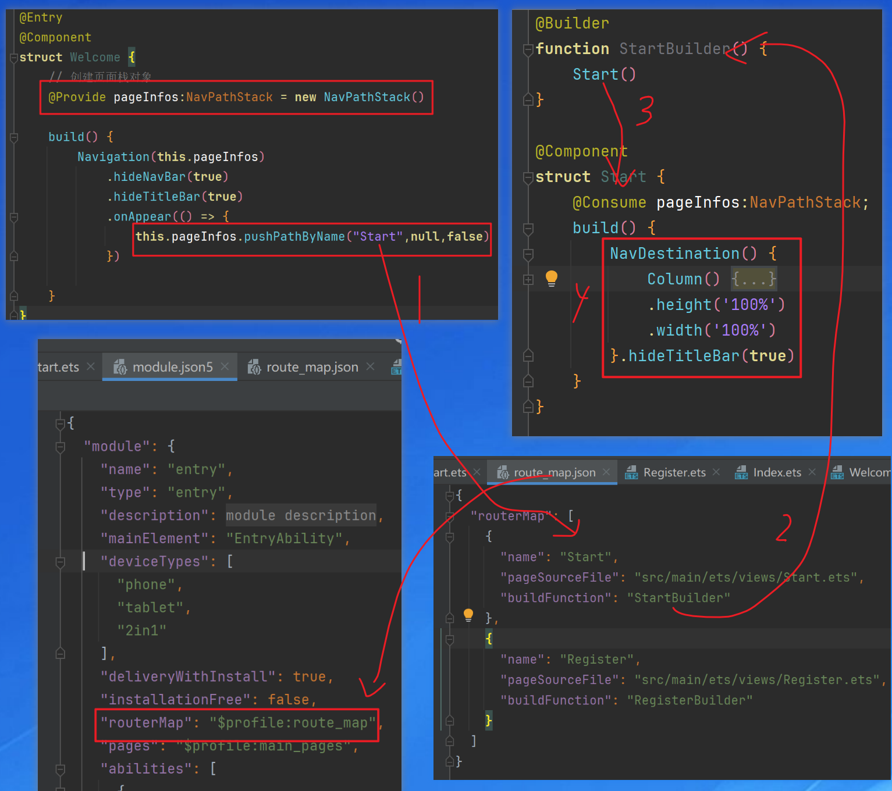

## 知聊项目

在万物智联与信息过载的双重背景下，用户对即时通讯工具的需求已从“功能堆砌”升级为“场景化智能体验”。为响应这一趋势，“知聊APP”依托鸿蒙操作系统（HarmonyOS），以“轻量化设计、智能化协同、全场景覆盖”为核心理念，重新定义下一代社交沟通范式。



### 组件导航和页面路由概述

页面是指由布局、组件、交互逻辑等构成的可视化交互单元，承载着特定功能逻辑与信息展示，是用户与应用进行操作交互的核心界面载体。一个完整的应用往往由多个页面组成，组件导航（Navigation）和页面路由（@ohos.router）均提供了应用内的页面跳转能力。

- 在组件导航（Navigation）框架下，“页面”通过NavDestination组件承载，特指一个NavDestination组件包含的内容。
- 在页面路由（@ohos.router）框架下，“页面”特指@Entry装饰的自定义组件。

相较而言，组件导航（Navigation）将页面放在Navigation组件内部进行跳转，具备更强的一次开发多端部署能力，可以进行更加灵活的页面栈操作，同时支持更丰富的动效和生命周期。因此，推荐使用组件导航（Navigation）来实现页面跳转以及组件内的跳转，以获得更佳的使用体验。

#### 页面路由

```
  router.pushUrl({url: 'pages/TestPage'})
```


#### 组件导航






#### 网络通讯

 


